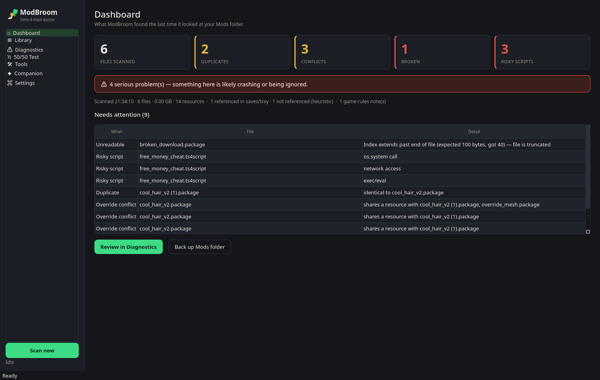
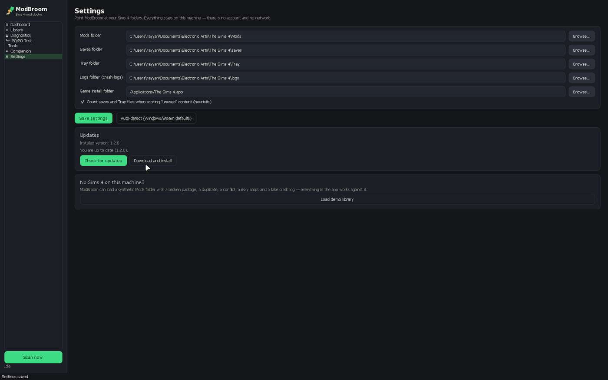

# ModBroom

[](https://github.com/Sipper1236/modbroom/actions/workflows/windows.yml)
[](https://github.com/Sipper1236/modbroom/actions/workflows/windows.yml)
[](LICENSE)

A free, local desktop app for **The Sims 4** that finds broken, duplicate, conflicting and risky mods — no account, no subscription, no network calls, and nothing leaves your machine.

It is the grown-up answer to "which of these 1,400 files is crashing my game."

## Screenshots

**Dashboard** — scan results at a glance, with severity-tinted cards and a plain-language health verdict:



**Settings → Updates** — the packaged Windows exe checking GitHub Releases (pictured running under Wine on Linux):



## What it does

- **Real DBPF parsing** — reads the actual binary `.package` format (header, index, zlib **and EA RefPack** resources). Not filename guessing.
- **Diagnostics** — conflicts (same resource ID in multiple packages), duplicates (byte-identical and identical-resource-set), truncated/corrupt packages, unreadable files.
- **Load-order prediction** — parses `Resource.cfg` (`Priority` / `PackedFile`), applies the game's rules, and tells you **which mod wins** an override conflict and why, instead of just listing the losers.
- **Script-mod analysis** — scans `.ts4script` archives for risky patterns (`os.system`, `exec`, network calls, Discord webhooks, `ctypes`, obfuscation).
- **Crash-log reader** — parses `LastException`/crash logs and ranks your script mods by suspicion.
- **50/50 bisect that actually works** — ModBroom physically moves your riskiest suspects out of Mods first (crash-log matches, broken packages, risky scripts), then halves the pool with each answer until it names the one file. Folder groups stay together, any answer can be undone, and a candidate can be rejected if the problem persists. Automatic backup first; everything reversible.
- **Quarantine** (reversible) and **permanent delete**.
- **Backups** (zip of your Mods folder), **manifest export** (JSON), **CSV export**, and a **standalone HTML report** you can attach to a forum post or send to someone for help.
- **Crash-proof paths**: OneDrive-redirected Documents, `.ts4script` nested too deep for the game to load, loose `.py` files the game ignores, `>259` char paths, dotfiles, zero-byte files, and the in-game checkboxes the game silently resets.
- **In-game companion** (optional): a real script mod (`ModBroomBridge.ts4script`) that adds `mb_status`, `mb_stats`, `mb_find`, `mb_help` cheat commands so you can ask the game about your Mods folder.
- **Demo library** if you have no game here — one click builds a synthetic Mods folder with every failure mode represented.
- **Self-updater** — in the packaged Windows exe, **Settings → Updates** checks GitHub Releases, shows the notes and installs the new exe with your confirmation, keeping a rollback copy until next launch.

## Run it

**Windows (the target platform)**

1. Install Python 3.10+ from python.org (tick "Add to PATH").
2. `pip install -r requirements.txt`
3. Double-click `run.bat`, or `python -m modbroom`

**Linux/macOS (for development)**

```
pip install -r requirements.txt
./run.sh
```

## Auto-updates

If you installed the packaged Windows exe, open **Settings → Updates → Check for updates**.
ModBroom checks the GitHub Releases API, tells you what changed, and only downloads or
replaces anything after you click **Download and install**. On Windows the running exe is
renamed rather than deleted (Windows will not let a running exe be overwritten); the new one
takes its name and the old one is cleaned up at the next launch. No telemetry — the only
network call is the release check itself.

Running from source (`python run.py`) there is no binary to replace, so the button explains
that and points you at the releases page.

**Download the Windows exe**

Every push builds `dist/ModBroom.exe` on GitHub Actions and attaches it to tagged releases — grab it from the [Releases](https://github.com/Sipper1236/modbroom/releases) page. It needs no Python install.

Or build it yourself:

```
pip install pyinstaller PySide6-Essentials
pyinstaller modbroom.spec
```

## First run

1. Hit **Scan now**. ModBroom auto-detects the usual Windows location (`Documents\Electronic Arts\The Sims 4\Mods`); if you keep it elsewhere, set it in **Settings**.
2. Read **Dashboard** for the headline, **Diagnostics** for the details.
3. Nothing is changed until you click something. Quarantine is always reversible from **Tools**.

No Sims 4? **Settings → Load demo library** builds a fake Mods folder so every feature works end to end.

## The in-game companion

**Companion** tab → **Install into my Mods folder**. Then in game: enable *Custom Content and Mods* and *Script Mods Allowed* in Options → Other, restart, open the cheat console (Ctrl+Shift+C), and type `mb_help`.

> Honest status: the companion is written against the public Sims 4 script-mod API (`sims4.commands`, `CheatOutput`). It is syntax-checked and packaged correctly, but **it has not been run inside the game** — there is no Sims 4 on the machine that built it. If a command does nothing in-game, that is why; the desktop app does not depend on it.

## The 50/50 wizard, in detail

1. Pick the suspects (Diagnostics pre-selects them).
2. ModBroom zips your whole Mods folder to `~/.modbroom/backups`, then moves half the suspects out of Mods.
3. You launch the game and reproduce (or not).
4. Click **Still broken** or **It's fixed**. The surviving half is split again.
5. When one file remains it is moved aside and named. Everything else is put back.

Every step is reversible from **Tools → Quarantine**; a pre-bisect backup is always taken first.

## Layout

```
modbroom/
  dbpf.py         DBPF parser (header / index / zlib + RefPack resources)
  refpack.py      EA RefPack decompressor (FB10) — implemented from the public spec
  loadorder.py    Resource.cfg parser + conflict-winner prediction
  scanner.py      walk Mods, duplicates, conflicts, integrity, script risk, usage
  game_rules.py   Sims-4-specific loading rules (depth, OneDrive, path length…)
  crashlog.py     crash-log parsing + suspect ranking
  bisect.py       the 50/50 engine (moves real files, with backup + undo)
  bridge.py       builds ModBroomBridge.ts4script + writes partner.json
  companion_src/  the in-game script mod (Python, zipped as .ts4script)
  store.py        settings, quarantine, backups, state
  core.py         scan pipeline shared by UI and CLI
  cli.py          headless scan (python -m modbroom --cli-scan)
  ui/             PySide6 app (theme, pages, widgets)
```

## How it compares

See [COMPARISON.md](COMPARISON.md) for a feature-by-feature comparison against the open-source tools people actually use for this (simscan and others), and where ModBroom deliberately differs.

## Running the tests

```
pip install pytest
python -m pytest tests -q
```

38 tests cover the DBPF parser, the RefPack codec (round-trip + corruption handling), `Resource.cfg` load order and conflict-winner prediction, the bisect engine, quarantine/restore, crash-log ranking, and the HTML report.

CI runs the same suite on Ubuntu, then builds the Windows exe on `windows-latest` and smoke-tests it before uploading the artifact.

## Honest limits

- It cannot tell you a mod is *safe*, only that it shows no known-risky patterns. Obfuscation defeats pattern matching.
- "Unused CC" means "no references found in your saves/Tray" — a hint, not proof.
- It does not repair `.package` files; it finds problems and moves files.
- The in-game companion has not been executed inside the real game.
- Not affiliated with Electronic Arts or Maxis.
